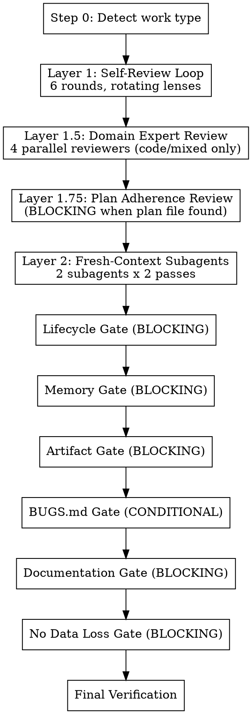

# Quality Gate

> **Note:** `{skill_dir}` refers to the absolute "Skill directory" path provided in your system instructions.

Automated multi-pass review with rotating adversarial lenses, fresh-context subagent reviews,
and blocking memory/artifact gates.

**Core principle:** One review pass catches ~60% of issues. Each additional pass with a DIFFERENT
lens catches more. Fresh-context review catches what same-context review cannot. Memory and
artifact gates prevent work from being lost.

## When to Invoke

**Always after:** implementation tasks, /swarm, /spawn, subagent work, research, planning,
significant artifact creation.

**Skip when:** pure conversation with no deliverables, or user explicitly opts out.

**Never skip "because it's trivial."** Small changes cause real failures. Don't rationalize
your way out of the process.

---

## Process Flow

---

## Step 0: Detect & Classify

Determine work type from session activity:

| Signal | Work Type |
|--------|-----------|
| `git diff` has results | **Code** |
| Plan file written to `{memory_dir}/plans/` | **Planning** |
| Research/analysis conversation, no file edits | **Research** |
| Edits to `.md`, `.yaml`, `.json`, `.toml` config | **Config/Artifact** |
| Short Q&A, no tool use | **Question** |
| Multiple of the above | **Mixed** (apply all relevant criteria) |

Select the lens set for the detected type (see `[{skill_dir}/references/lens-rubrics.md](./references/lens-rubrics.md)`).

**Test plan discovery (Planning/Mixed/Code work types):** Search `{memory_dir}/plans/` by `**Branch:**` header match (fallback: branch slug prefix; use most recent timestamp). If found, store `{plan_file_path}` and `{plan_content}` for Layer 1.75 and the Lifecycle Gate. If the plan has a `## Test Plan` section, normalize `**Test Plan:**` (resolve `..`, strip trailing slashes) and verify it stays within `{memory_dir}/test-plans/`. If it escapes, set `{plan_test_plan}` = `""` and log a warning; if missing, set `{plan_test_plan}` = `""`; if valid and present, read into `{plan_test_plan}` for Layer 1 (Rounds 2 and 5) and Layer 2 (Subagent A).

**Incremental workflow scoping:** When invoked during an incremental swarm run (`pr_boundary_files` provided), scope all review passes to only the files in `pr_boundary_files`. When standalone, review all changed files.

---

## Layer 1: Self-Review Loop

**6 rounds (Round 6: Structural applies to Code/Mixed only). All rounds are mandatory — do not exit early.**

Each round uses a different adversarial lens. Rotating lenses prevent anchoring fatigue and ensure
comprehensive coverage from different angles.

### Lens Rotation

| Round | Lens | Core Question |
|-------|------|---------------|
| 1 | **Correctness** | What inputs produce wrong results? What assumptions are untested? |
| 2 | **Completeness** | What was requested but not delivered? Read the original request word-by-word. Includes documentation completeness (see below). For Planning/Mixed work: also check completeness against any UAT scenarios discovered in Step 0. |
| 3 | **Robustness** | How does this fail? Bad input, missing deps, concurrent access, edge cases? |
| 4 | **Simplicity (BLOCKING)** | What's over-engineered? What could be deleted? What's AI slop? Dead code, unnecessary abstractions, and unused imports are `needs-fix` — blocking. |
| 5 | **Adversarial** | You are a hostile reviewer. The author claims this is done. Prove them wrong. For Planning/Mixed work with UAT scenarios (loaded in Step 0): assume you are a hostile QA tester — can you construct inputs that would break each UAT scenario? If not, the scenarios may be under-specified. |
| 6 | **Structural** | What design flaws, race conditions, or failure modes exist in this system's architecture — not just in the current change, but in how it integrates? (Code/Mixed only) |

Table shows code lenses. Other work types adapt lens names — e.g., planning uses "Feasibility"
for Round 1, Q&A uses a reduced 3-round review. See `[{skill_dir}/references/lens-rubrics.md](./references/lens-rubrics.md)` for all
work-type-specific lens prompts.

### Skill Integration Per Round

- **Round 1:** Spawn domain reviewers (`code-quality:security`, `code-quality:qa`, `code-quality:performance`) for code files. Use `sequential-thinking` MCP for decomposed reasoning.
- **Round 2:** Use `sequential-thinking` MCP. Apply first-principles: break original request into
  atomic requirements, check each independently.
- **Round 4 (BLOCKING):** Calculate net lines delta (`git diff --stat`). Spawn
  `code-quality:code-simplifier` with the delta as context. Apply the full checklist from
  `[{skill_dir}/../../references/simplification-checklist.md](../../references/simplification-checklist.md)`. Dead code, unnecessary abstractions,
  and unused imports are `needs-fix` findings — they BLOCK proceeding to Round 5. Fix all
  such simplification findings before continuing. These are objectively wasteful, not
  judgment calls.
- **Round 5:** First-principles: "State the fundamental purpose in one sentence. Review against
  that purpose, not the structure you created."

**MCP tool availability:** If Serena (`think_about_*`) or `sequential-thinking` MCP tools are
unavailable, use extended thinking to perform the same metacognitive checks. The tools enforce
structured reasoning; without them, be explicit about pausing to reason through the same questions.

### Round Execution Protocol

Execute this 7-step protocol for EVERY round (see `[{skill_dir}/references/lens-rubrics.md](./references/lens-rubrics.md)` for full Step 3 & Step 5 trap catalogs):

1. **`serena::think_about_task_adherence`** — "Is this round's review still aligned with the original request?"
2. **APPLY THE LENS** — Check every modified file, function, and edge case exhaustively from first principles until genuinely out of things to check.
3. **PROJECT RULES + CROSS-REFERENCE INTEGRITY (Round 2 only)** — Re-read `CLAUDE.md`/`CONTRIBUTING.md` for version bumps, manifests, and conventions; check documentation triggers against `[{skill_dir}/../../references/documentation-taxonomy.md](../../references/documentation-taxonomy.md)`; verify UAT scenario coverage against `{plan_test_plan}` (Planning/Mixed); and grep the codebase for stale cross-references to renamed/removed items.
4. **FIX ALL FINDINGS IMMEDIATELY** — Every identified issue must result in an edit or a documented, specific blocker.
5. **ACTION AUDIT** — Scan all output (yours and subagents' `last_assistant_message`) for identified-but-unactioned items and enforce the 4 anti-deferral trap gates defined in `[{skill_dir}/references/lens-rubrics.md](./references/lens-rubrics.md)`:
   - **THE "DEFERRAL-TO-USER" TRAP** ("should be verified" / "you should check" → verify it yourself)
   - **THE "PREEXISTING" TRAP** ("pre-existing" → investigate root cause and verify against baseline)
   - **THE "SELF-SCOPING" TRAP / SELF-SCOPING TRAP** ("v1"/"v2"/"future iteration" → implement or present via `AskUserQuestion`; never self-scope)
   - **THE "NOT MY REVIEW" TRAP** (PR diff is the scope boundary, not prior review output)
6. **FINDING COUNT TRACKING** — Record `finding_count[round_N]`. If `N >= 3` and `finding_count[round_N] > finding_count[round_N-1]`, print oscillation warning.
7. **`serena::think_about_whether_you_are_done`** — "Did I genuinely address everything this lens covers?"

### No Early Exit, Valid Zero Findings & Adaptive Rounds 5-6

- **No Early Exit:** All 6 rounds are mandatory for Code/Mixed (Rounds 1-5 for non-Code). Never exit early because a round produced zero findings — each lens catches categorically different issues.
- **Valid Zero Findings:** Reporting zero findings after genuine investigation is valid — do not fabricate findings.
- **Adaptive Rounds 5-6:** If rounds 1-4 collectively produced `< 2` `needs-fix` findings, rounds 5-6 run in **scan-only mode**: apply the full lens checklist and record `[scan-only]` findings for Layer 2 verification instead of fixing immediately (unless clearly critical like security or data loss).

---

## Layer 1.5: Domain Expert Review

**Applies to: Code and Mixed work types only (mandatory — never skip for code work).** Skip for Research, Planning, Config, and Question work types.

### Reviewer Spawning (4 in parallel)

Spawn all 4 domain reviewers simultaneously (`model="sonnet"`, receiving `git diff`, verbatim user request, and `CLAUDE.md`/`CONTRIBUTING.md`) using the prompts in `[{skill_dir}/references/subagent-prompts.md](./references/subagent-prompts.md)`:
1. **Security** (`code-quality:security`) — Domain Reviewer: Security
2. **QA** (`code-quality:qa`) — Domain Reviewer: QA
3. **Performance** (`code-quality:performance`) — Domain Reviewer: Performance
4. **Code Review** (`code-quality:code-reviewer`) — Domain Reviewer: Code-Reviewer

### Synthesis Protocol

After all 4 reviewers complete, synthesize findings per `[{skill_dir}/../../references/finding-classification.md](../../references/finding-classification.md)`:
1. Fix all `needs-fix` findings immediately.
2. For `needs-input` findings: first apply the de-escalation test from `[{skill_dir}/../../references/finding-classification.md](../../references/finding-classification.md)` (reclassify to `needs-fix` if a single correct resolution exists). Present remaining `needs-input` findings via `AskUserQuestion` (up to 4 per call, `multiSelect: false`, 2-4 mutually exclusive options + `Defer`, with `"[{id}] {description}\n\nLoE: {loe}\nDecision needed: {input_needed}\n▸dp:file={file},line={line},cat={reviewer},skill=quality-gate"`). Fix approved items and record `user_deferred` items. (If `AskUserQuestion` is unavailable, surface as `needs_context` in the report.)
3. **Verification:** Verify `total_findings == findings_fixed + user_deferred` before proceeding to Layer 2.

---

## Layer 1.75: Plan Adherence Review

**Trigger:** Reuse `{plan_file_path}` and `{plan_content}` from Step 0 (if no plan file, skip with `"No plan file found — skipping plan adherence check."`). When a plan file exists, Layer 1.75 is **BLOCKING**.

Spawn `code-quality:plan-adherence` (`model="opus"`, prompt in `[{skill_dir}/references/subagent-prompts.md](./references/subagent-prompts.md)`, Layer 1.75) with `{plan_file_path}`, `{plan_content}`, `git diff`, changed files, and user request. Wait for any `AskUserQuestion` escalations on unchecked tasks (`[SKIPPED by user]`, `[BLOCKED: reason]`, or return to implementation). Retry once on crash/timeout; if still failing, mark `[UNREVIEWED]`.

---

## Layer 2: Fresh-Context Subagent Reviews

**Layer 2 is NEVER optional and NEVER substitutable** (prior swarm Phase 4 or Layer 1.5 reviews do not replace it — Layer 2 reviews the final post-fix state with zero anchoring using holistic Completeness and Adversarial lenses).

### Preparation

Run `serena::think_about_collected_information` and collect: `git diff` (or artifact content), verbatim user request, Step 0 work type, `CLAUDE.md`/`CONTRIBUTING.md`, `{plan_content}` (for Subagent A; `'No plan file found.'` if skipped), and `{plan_test_plan}` (for Subagent A only; omit the `UAT TEST PLAN` section entirely when empty).

### Subagent Execution (2 passes each — BOTH mandatory)

Each subagent runs **2 mandatory passes** using `[{skill_dir}/references/subagent-prompts.md](./references/subagent-prompts.md)`:
- **Pass 1:** Spawn **Subagent A (Completeness Reviewer, opus)** and **Subagent B (Adversarial Reviewer, opus)** via `Agent(model="opus")`, save each `agentId`, and fix ALL Pass 1 findings.
- **Pass 2 (MANDATORY):** Resume each Pass 1 agent via `SendMessage(to=<agentId from Pass 1>, ...)` (MUST use `agentId`, not agent name) with `{summary_of_fixes}` asking it to verify fixes and check for blind spots. **Wait for both Pass 2 responses** before proceeding to the gates (if no response within 2 minutes, perform the Pass 2 verification yourself) and fix all Pass 2 findings.

---

## Gates & Final Verification

Execute all 6 gates in order using the full check tables, remediation rules, and terminal output template in `[{skill_dir}/references/gate-specifications.md](./references/gate-specifications.md)`:

1. **Lifecycle Gate (BLOCKING):** If `{plan_file_path}` exists and has an `**Iterations:**` block, verify all 5 counters (`review-cycle`, `fix-cycle`, `pr-review-cycle`, `pr-fix-cycle`, `quality-gate`) are present with integer values >= 0 (auto-remediate missing counters at 0; check logical/behavioral advisory warnings). On PASS, re-read `{plan_file_path}` and increment `- quality-gate: {N}` to `- quality-gate: {N+1}` via `Edit`.
2. **Memory Gate (BLOCKING):** Update `{memory_dir}/TODO.md`, `PROJECT.md`, `NEXT.md`, `SESSIONS.md`, `LESSONS.md`, `plans/`, `claude-mem`, and Serena memories per `[{skill_dir}/../../references/project-memory-reference.md](../../references/project-memory-reference.md)`.
3. **Artifact Gate (BLOCKING):** Verify work-type deliverables, re-verify `CLAUDE.md` version/manifest rules, and check upstream PR state via the GitHub MCP `pull_request_read` tool or `gh pr view`.
4. **BUGS.md Verification Gate (CONDITIONAL):** When `{memory_dir}/BUGS.md` exists, reconcile `**Tracked In:** —` (or missing field) and existing `**Tracked In:**` references against branch files (`git diff --name-only origin/main...HEAD`, matching by exact path after stripping `:NN` or common directory prefix of at least 3 components) and PR status via `pull_request_read` or `gh pr view`.
5. **Documentation Gate (BLOCKING):** Verify code→docs completeness and cross-surface consistency against `[{skill_dir}/../../references/documentation-taxonomy.md](../../references/documentation-taxonomy.md)`.
6. **No Data Loss Gate (BLOCKING):** Confirm every artifact is persisted to a durable, externally-trackable location (pushed branch + PR, `{memory_dir}/plans/`, `{memory_dir}/research/`, `PROJECT.md` — never working-tree-only).
7. **Final Verification & Output:** Run the test suite + lint (or re-read plan/research/config end-to-end), run `serena::think_about_whether_you_are_done`, and print the `QUALITY GATE` report from `[{skill_dir}/references/gate-specifications.md](./references/gate-specifications.md)`.
