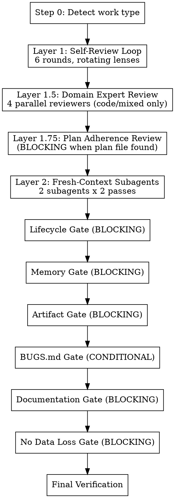

# Quality Gate

> **Note:** `{skill_dir}` refers to the absolute "Skill directory" path provided in your system instructions.

Automated multi-pass review with rotating adversarial lenses, fresh-context subagent reviews,
and blocking memory/artifact gates.

**Core principle:** One review pass catches ~60% of issues. Each additional pass with a DIFFERENT
lens catches more. Fresh-context review catches what same-context review cannot. Memory and
artifact gates prevent work from being lost.

## When to Invoke

**Always after:** implementation tasks, /swarm, /spawn, subagent work, research, planning,
significant artifact creation.

**Skip when:** pure conversation with no deliverables, or user explicitly opts out.

**Never skip "because it's trivial."** Small changes cause real failures. Don't rationalize
your way out of the process.

---

## Process Flow



---

## Step 0: Detect & Classify

Determine work type from session activity:

| Signal | Work Type |
|--------|-----------|
| `git diff` has results | **Code** |
| Plan file written to `{memory_dir}/plans/` | **Planning** |
| Research/analysis conversation, no file edits | **Research** |
| Edits to `.md`, `.yaml`, `.json`, `.toml` config | **Config/Artifact** |
| Short Q&A, no tool use | **Question** |
| Multiple of the above | **Mixed** (apply all relevant criteria) |

Select the lens set for the detected type (see `[{skill_dir}/references/lens-rubrics.md](./references/lens-rubrics.md)`).

**Test plan discovery (Planning/Mixed/Code work types):** After classifying the work type,
discover the plan file using branch-header matching (same algorithm as Layer
1.75: search `{memory_dir}/plans/` for files whose `**Branch:**` header matches the current git
branch; fallback to branch slug prefix matching; use most recent by unix timestamp if multiple
match). If a plan file is found, store its absolute path as `{plan_file_path}` and its content
as `{plan_content}`. These are consumed by Layer 1.75 and the Lifecycle Gate. If a plan file
is found and it contains a `## Test Plan` section, read the `**Test Plan:**`
path annotation from that section. Normalize the path (resolve any `..` components, strip
trailing slashes) and verify it falls within `{memory_dir}/test-plans/`. If the path escapes
that directory, set `{plan_test_plan}` to empty string and log a warning:
"Warning: test plan path escapes {memory_dir}/test-plans/ boundary — setting {plan_test_plan}
to empty string." If the path is valid but the file does not exist, set `{plan_test_plan}` to
empty string (graceful fallback — no warning). If the path is valid and the file exists,
read the test plan file and store its content as `{plan_test_plan}`. This
value is available to all subsequent layers (Layer 1 Rounds 2 and 5, and Layer 2 Subagent A).
If no plan file is found for the current branch, set `{plan_test_plan}` to empty string.

**Incremental workflow scoping:** When invoked during an incremental swarm run (the swarm Lead
passes a `pr_boundary_files` list), scope all review passes to only the files in that list.
Findings for files outside the boundary are not collected, not reviewed, and not counted.
When invoked standalone (no `pr_boundary_files` context): existing behavior unchanged — review
all changed files.

---

## Layer 1: Self-Review Loop

**6 rounds (Round 6: Structural applies to Code/Mixed only). All rounds are mandatory — do not exit early.**

Each round uses a different adversarial lens. Rotating lenses prevent anchoring fatigue and ensure
comprehensive coverage from different angles.

### Lens Rotation

| Round | Lens | Core Question |
|-------|------|---------------|
| 1 | **Correctness** | What inputs produce wrong results? What assumptions are untested? |
| 2 | **Completeness** | What was requested but not delivered? Read the original request word-by-word. Includes documentation completeness (see below). For Planning/Mixed work: also check completeness against any UAT scenarios discovered in Step 0. |
| 3 | **Robustness** | How does this fail? Bad input, missing deps, concurrent access, edge cases? |
| 4 | **Simplicity (BLOCKING)** | What's over-engineered? What could be deleted? What's AI slop? Dead code, unnecessary abstractions, and unused imports are `needs-fix` — blocking. |
| 5 | **Adversarial** | You are a hostile reviewer. The author claims this is done. Prove them wrong. For Planning/Mixed work with UAT scenarios (loaded in Step 0): assume you are a hostile QA tester — can you construct inputs that would break each UAT scenario? If not, the scenarios may be under-specified. |
| 6 | **Structural** | What design flaws, race conditions, or failure modes exist in this system's architecture — not just in the current change, but in how it integrates? (Code/Mixed only) |

Table shows code lenses. Other work types adapt lens names — e.g., planning uses "Feasibility"
for Round 1, Q&A uses a reduced 3-round review. See `[{skill_dir}/references/lens-rubrics.md](./references/lens-rubrics.md)` for all
work-type-specific lens prompts.

### Skill Integration Per Round

- **Round 1:** Spawn domain reviewers (`code-quality:security`, `code-quality:qa`, `code-quality:performance`) for code files. Use `sequential-thinking` MCP for decomposed reasoning.
- **Round 2:** Use `sequential-thinking` MCP. Apply first-principles: break original request into
  atomic requirements, check each independently.
- **Round 4 (BLOCKING):** Calculate net lines delta (`git diff --stat`). Spawn
  `code-quality:code-simplifier` with the delta as context. Apply the full checklist from
  `[{skill_dir}/../../references/simplification-checklist.md](../../references/simplification-checklist.md)`. Dead code, unnecessary abstractions,
  and unused imports are `needs-fix` findings — they BLOCK proceeding to Round 5. Fix all
  such simplification findings before continuing. These are objectively wasteful, not
  judgment calls.
- **Round 5:** First-principles: "State the fundamental purpose in one sentence. Review against
  that purpose, not the structure you created."

**MCP tool availability:** If Serena (`think_about_*`) or `sequential-thinking` MCP tools are
unavailable, use extended thinking to perform the same metacognitive checks. The tools enforce
structured reasoning; without them, be explicit about pausing to reason through the same questions.

### Round Execution Protocol

Execute this 7-step protocol for EVERY round (see `[{skill_dir}/references/lens-rubrics.md](./references/lens-rubrics.md)` for the full verbatim 7-step Round Execution Protocol and Step 3 & Step 5 trap catalogs):

1. **`serena::think_about_task_adherence`** — "Is this round's review still aligned with the original request?"
2. **APPLY THE LENS** — Check every modified file, function, and edge case exhaustively from first principles until genuinely out of things to check.
3. **PROJECT RULES + CROSS-REFERENCE INTEGRITY (Round 2 only)** — Re-read `CLAUDE.md`/`CONTRIBUTING.md` for version bumps, manifests, and conventions; check documentation triggers against `[{skill_dir}/../../references/documentation-taxonomy.md](../../references/documentation-taxonomy.md)`; verify UAT scenario coverage against `{plan_test_plan}` (Planning/Mixed); and grep the codebase for stale cross-references to renamed/removed items.
4. **FIX ALL FINDINGS IMMEDIATELY** — Every identified issue must result in an edit or a documented, specific blocker.
5. **ACTION AUDIT** — Scan all output (yours and subagents' `last_assistant_message`) for identified-but-unactioned items and enforce the 4 anti-deferral trap gates defined in `[{skill_dir}/references/lens-rubrics.md](./references/lens-rubrics.md)`:
   - **THE "DEFERRAL-TO-USER" TRAP** ("should be verified" / "you should check" → verify it yourself)
   - **THE "PREEXISTING" TRAP** ("pre-existing" → investigate root cause and verify against baseline)
   - **THE "SELF-SCOPING" TRAP / SELF-SCOPING TRAP** ("v1"/"v2"/"future iteration" → implement or present via `AskUserQuestion`; never self-scope)
   - **THE "NOT MY REVIEW" TRAP** (PR diff is the scope boundary, not prior review output)
6. **FINDING COUNT TRACKING** — Record `finding_count[round_N]`. If `N >= 3` and `finding_count[round_N] > finding_count[round_N-1]`, print oscillation warning.
7. **`serena::think_about_whether_you_are_done`** — "Did I genuinely address everything this lens covers?"

### No Early Exit

**All 6 rounds are mandatory for Code and Mixed work types.** Each round uses a categorically
different lens — a clean Round 3 says nothing about Round 4 (Simplicity catches AI slop and
over-engineering), Round 5 (Adversarial catches what you rationalized away), and Round 6
(Structural catches integration issues invisible to single-component review).

For non-Code work types: Rounds 1-5 always run. Round 6 (Structural) is skipped since it
targets code architecture integration.

Do NOT exit early because a round "produced zero findings." Each lens catches categorically
different issues. The next round will find what this round cannot see.

### Valid Zero Findings

Reporting zero findings for a round is a valid outcome — it means this lens found nothing
wrong, not that you didn't look hard enough. Do not fabricate findings to satisfy the "do not
exit early" instruction. "Do not exit early" means run the lens thoroughly — it does not mean
you must find something. An honest "no issues under this lens" after genuine investigation is
the correct result when the work is sound.

### Adaptive Rounds 5-6

If rounds 1-4 collectively produced fewer than 2 needs-fix findings, rounds 5-6 shift to
**scan-only mode**: run the lens as analysis but report findings for Layer 2 subagent
verification instead of applying "fix immediately." This respects the empirical observation that
most improvement occurs in early rounds, while preserving lens diversity.

In scan-only mode:
- Still apply the full lens checklist — do not skip the analysis
- Record findings with `[scan-only]` prefix
- Do NOT apply step 4 (FIX ALL FINDINGS IMMEDIATELY) — instead, carry findings to Layer 2
- Layer 2 subagents receive scan-only findings as additional context for verification
- If a scan-only finding is clearly critical (security vulnerability, data loss), override
  scan-only and fix immediately — use judgment, not a blanket rule

---

## Layer 1.5: Domain Expert Review

**Applies to: Code and Mixed work types only.** Skip for Research, Planning, Config, and
Question work types.

Domain reviewers catch categories of issues that self-review lenses systematically miss:
security vulnerabilities require dedicated adversarial security reasoning; performance issues
require cost-model thinking; QA issues require test coverage analysis; code review issues
require holistic style and maintainability assessment. Layer 1 cannot replicate these because
each domain has its own expert heuristics.

**Layer 1.5 is NOT optional for code work.** Do not skip it because Layer 1 "seemed thorough."

### Trigger

Work type is **Code** or **Mixed** (with a code component).

### Reviewer Spawning (4 in parallel)

Spawn all 4 reviewers simultaneously (`code-quality:security`, `code-quality:qa`, `code-quality:performance`, `code-quality:code-reviewer`, all `model="sonnet"`) using the exact `Agent(...)` dispatch block in `[{skill_dir}/references/gate-specifications.md](./references/gate-specifications.md)` and prompt templates in `[{skill_dir}/references/subagent-prompts.md](./references/subagent-prompts.md)`.

Each reviewer receives:
- `git diff` of all changes
- The original user request (verbatim)
- CLAUDE.md / CONTRIBUTING.md project rules (if they exist)

### Synthesis Protocol

After all 4 reviewers complete, synthesize findings by classification
(see `[{skill_dir}/../../references/finding-classification.md](../../references/finding-classification.md)`):

1. Collect all findings across the 4 reviewers
2. Fix all `needs-fix` findings immediately. Do not carry them forward.
3. For `needs-input` findings: present each individually via AskUserQuestion (one question
   per finding, batch up to 4 per call). Each question includes full context:
   `"[{id}] {description}\n\nLoE: {loe}\nDecision needed: {input_needed}\n▸dp:file={file},line={line},cat={reviewer},skill=quality-gate"`
   For each `needs-input` finding, the Lead first applies de-escalation (see Note below).
   For findings that remain `needs-input` after de-escalation, present via AskUserQuestion
   with the Lead-generated options + Defer appended as the final option. `multiSelect: false`.
   User selects an approach or defers. Fix approved items using the selected approach —
   record the selected option label in the finding's `suggested_fix` field per the Record
   Decisions convention. Record deferred items with reason.
4. Do NOT proceed to Layer 2 until all `needs-fix` items are fixed and all
   `needs-input` items are resolved via user decision.

**Note:** Quality-gate domain reviewers do not go through a Finding Verifier. When a
domain reviewer classifies a finding as `needs-input`, the Lead applies the de-escalation
test from `[{skill_dir}/../../references/finding-classification.md](../../references/finding-classification.md)` before presenting to the
user. If the finding has a single correct resolution, reclassify to `needs-fix` and fix
it. If genuine ambiguity exists, generate 2-4 concrete options per the Option Quality
section in `[{skill_dir}/../../references/finding-classification.md](../../references/finding-classification.md)` (labels 3-7 words, include
tradeoff in description, mutually exclusive) and present via AskUserQuestion with Defer
appended.

**Finding completion verification:** After fixing all `needs-fix` items and resolving all
`needs-input` items, verify completeness per `[{skill_dir}/../../references/finding-classification.md](../../references/finding-classification.md)`
Verification Protocol: count total findings from all 4 reviewers vs (findings fixed +
user-deferred items). Delta > 0 → findings were silently dropped → fix them before Layer 2.

If AskUserQuestion is unavailable during synthesis, treat all `needs-input` findings as
`needs_context` - surface them in the quality gate output report (don't hide them, don't
block on them). Do NOT silently drop needs-input findings because the tool is unavailable.

**The synthesis step is not optional.** If you find yourself writing "domain review skipped"
or "findings noted for later," stop. Fix the needs-fix findings now.

---

## Layer 1.75: Plan Adherence Review

**Trigger:** Reuse `{plan_file_path}` and `{plan_content}` from Step 0. If Step 0 did not
discover a plan file, skip Layer 1.75 with note: "No plan file found — skipping plan
adherence check."

**Gate behavior:** When a plan IS found, Layer 1.75 is BLOCKING — cannot proceed to Layer 2
without completing plan verification. REQUIRED gate when a plan file exists.

**Execution:**

```
Agent(
  description="Plan adherence review",
  subagent_type="code-quality:plan-adherence",
  model="opus",
  prompt=<see [{skill_dir}/references/subagent-prompts.md](./references/subagent-prompts.md), Layer 1.75: Plan Adherence Reviewer>
)
```

Provide: plan file path, plan file content (`{plan_content}`), `git diff`, changed file list,
original user request. Store `{plan_content}` in context so Layer 2 Subagent A can receive it.

**Escalation handling:** If the plan-adherence agent triggers AskUserQuestion for unchecked
tasks, the quality gate waits for user responses. User can:
- Approve skip (`[SKIPPED by user]`)
- Mark blocked (`[BLOCKED: reason]`)
- Request implementation (quality gate fails, returns to implementation)

**Output:** Plan Adherence findings included in quality gate output report.

**Failure handling:** If the agent crashes or times out, retry once. If the second attempt
fails, mark as `[UNREVIEWED]` and proceed with note. If AskUserQuestion is unavailable, report
unchecked tasks as `needs-fix` findings.

---

## Layer 2: Fresh-Context Subagent Reviews

Same-context review has an anchoring ceiling. Fresh-context subagents break through it by
reviewing with no knowledge of your implementation decisions.

**Layer 2 is NEVER optional and NEVER substitutable.** Do not skip it because the change "seems
trivial" or subagents feel "disproportionate." Do not substitute it with prior review work —
swarm Phase 4 reviewers, domain reviewer output, or any other earlier review does NOT replace Layer 2.

**Why Layer 2 is distinct from all prior reviews:**
- **Timing:** Layer 2 reviews the FINAL state — after Layer 1 fixes, after any swarm Phase 5
  fixes, after everything. Prior reviews examined earlier, now-stale versions of the work.
- **Lens:** Layer 2 uses holistic lenses (completeness-vs-original-request, adversarial).
  Domain-specific reviewers (security, performance, QA) cover different ground.
- **Context:** Layer 2 subagents have zero knowledge of your implementation decisions,
  rationalizations, or "good enough" compromises. Prior reviewers in the same session share
  your context ceiling.

If you find yourself writing "SUBSTITUTED by" or "already covered by" for Layer 2, you are
rationalizing. Stop. Spawn the subagents. If the change is truly trivial, the subagents
finish quickly — that's cheap insurance, not wasted effort.

### Preparation

```
serena::think_about_collected_information
→ "What context do the subagents need to review effectively?"
```

Collect:
- `git diff` (for code) or artifact content (for non-code)
- The original user request (verbatim)
- Work type classification from Step 0
- CLAUDE.md / CONTRIBUTING.md project rules (if they exist) — subagents need these
  to check project convention compliance
- `{plan_content}` — plan content discovered by Layer 1.75 (if a plan was found). Pass to
  Subagent A (Completeness Reviewer) via the `{plan_content}` placeholder. Value is the plan
  file content or `'No plan file found.'` if Layer 1.75 was skipped.
- `{plan_test_plan}` — UAT test plan content loaded in Step 0. Pass to Subagent A
  (Completeness Reviewer) only. Value is the test plan file content or empty string if Step 0
  did not load a test plan. Subagent B does NOT receive this context.
  When `{plan_test_plan}` is empty string, omit the `UAT TEST PLAN` section entirely from the
  Subagent A prompt — do not render the heading, label, or empty placeholder.

### Subagent Execution (2 passes each — BOTH mandatory)

Each subagent runs TWO passes. Pass 2 is NOT optional — it catches issues the subagent
missed on Pass 1 and verifies your fixes didn't introduce new problems.

Pass 2 resumes the Pass 1 agent via `SendMessage` using the **agent ID** (not the name).
This preserves the agent's full conversation history from Pass 1. You MUST use the agent
ID returned in the Pass 1 result — using the agent name routes to a team inbox instead.

**CRITICAL — Pass 2 synchronization:** `SendMessage` is asynchronous — it returns immediately
but the agent's response arrives later as a teammate notification. You MUST wait for each
Pass 2 response before proceeding. Do NOT move to Memory Gate or any subsequent gate until
BOTH Pass 2 responses are received and all findings are fixed. "Message sent" is not
"response received." If the agent does not respond within 2 minutes, re-do the Pass 2 check
yourself: re-read the files you fixed and verify the fixes are semantically correct (not just
syntactically applied). A self-performed Pass 2 is better than a skipped one.

Run **Subagent A: Completeness Reviewer (opus)** and **Subagent B: Adversarial Reviewer (opus)** across Pass 1 (`Agent(model="opus")`) and Pass 2 (`SendMessage(to=<agentId from Pass 1>, ...)`) using the exact execution blocks in `[{skill_dir}/references/gate-specifications.md](./references/gate-specifications.md)` and prompts in `[{skill_dir}/references/subagent-prompts.md](./references/subagent-prompts.md)`.

**Why Pass 2 matters:** Pass 1 finds issues. You fix them. But fixes can introduce NEW
issues, and the subagent's first pass always misses something (fresh eyes still have blind
spots). Pass 2 catches both. Skipping it is like running tests once, making changes, and
not re-running them.

---

## Gates & Final Verification

Execute all 6 gates in order using the full check tables, remediation rules, and terminal output template in `[{skill_dir}/references/gate-specifications.md](./references/gate-specifications.md)`:

1. **Lifecycle Gate (BLOCKING):** If `{plan_file_path}` exists and has an `**Iterations:**` block, verify all 5 counters (`review-cycle`, `fix-cycle`, `pr-review-cycle`, `pr-fix-cycle`, `quality-gate`) are present with integer values >= 0 (auto-remediate missing counters at 0; check logical/behavioral advisory warnings). On PASS, re-read `{plan_file_path}` and increment `- quality-gate: {N}` to `- quality-gate: {N+1}` via `Edit`.
2. **Memory Gate (BLOCKING):** Update `{memory_dir}/TODO.md`, `PROJECT.md`, `NEXT.md`, `SESSIONS.md`, `LESSONS.md`, `plans/`, `claude-mem`, and Serena memories per `[{skill_dir}/../../references/project-memory-reference.md](../../references/project-memory-reference.md)`.
3. **Artifact Gate (BLOCKING):** Verify work-type deliverables, re-verify `CLAUDE.md` version/manifest rules, and check upstream PR state via the GitHub MCP `pull_request_read` tool or `gh pr view`.
4. **BUGS.md Verification Gate (CONDITIONAL):** When `{memory_dir}/BUGS.md` exists, reconcile `**Tracked In:** —` (or missing field) and existing `**Tracked In:**` references against branch files (`git diff --name-only origin/main...HEAD`, matching by exact path after stripping `:NN` or common directory prefix of at least 3 components) and PR status via `pull_request_read` or `gh pr view`.
5. **Documentation Gate (BLOCKING):** Verify code→docs completeness and cross-surface consistency against `[{skill_dir}/../../references/documentation-taxonomy.md](../../references/documentation-taxonomy.md)`.
6. **No Data Loss Gate (BLOCKING):** Confirm every artifact is persisted to a durable, externally-trackable location (pushed branch + PR, `{memory_dir}/plans/`, `{memory_dir}/research/`, `PROJECT.md` — never working-tree-only).
7. **Final Verification & Output:** Run the test suite + lint (or re-read plan/research/config end-to-end), run `serena::think_about_whether_you_are_done`, and print the `QUALITY GATE` report from `[{skill_dir}/references/gate-specifications.md](./references/gate-specifications.md)`.
